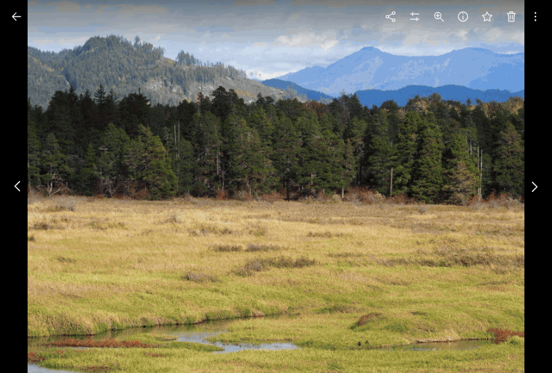

# Google Photos Cull

## Install

1. Install [Tampermonkey](https://www.tampermonkey.net/) for your browser.
2. Click [here to install](https://raw.githubusercontent.com/sinnrrr/google-photo-cull/main/google-photos-cull.user.js).
3. In the Tampermonkey window that opens, click **Install**.

Reload [Google Photos](https://photos.google.com/) after installation.

The same script works across desktop browsers supported by Tampermonkey, including Firefox, Chrome, Edge, and Safari.
